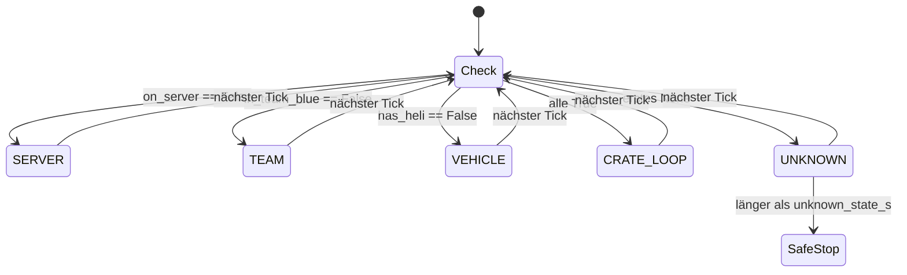
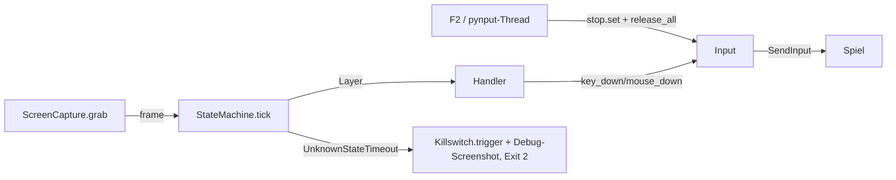

# Architektur

## Module (`src/heli_farmer/`)

| Modul | Aufgabe |
|---|---|
| `config.py` | `load_config(path)`: lädt `config.yaml`, merged `config.local.yaml` (gleiches Verzeichnis, optional) rekursiv darüber |
| `killswitch.py` | `Killswitch`: pynput-Keyboard-Listener, bei `keys.stop` → `stop.set()` + `on_stop()` (= `Input.release_all`). `wait(stop, s)` wirft `Stopped`. `key_name(key)` normalisiert pynput-Keys auf Strings (`"f2"`, `"w"`, `"space"`, `"vk<n>"`) |
| `inputs.py` | `Input`: `key_down/key_up/mouse_down/mouse_up` über pydirectinput (`SendInput`, Scan-Codes). Merkt gedrückte Tasten/Buttons, `release_all()`. Nach Stop wirft Drücken `Stopped`. `dry_run=True` loggt statt zu senden |
| `capture.py` | `ScreenCapture(region).grab()` → BGR `np.ndarray` (H×W×3, uint8) der Spielregion via `mss`. mss-Instanz pro Thread/Prozess erzeugen |
| `logs.py` | `setup_logging(root, level, name)` → `logs/<YYYY-MM-DD>/<name>_<HHMMSS>.log` + Konsole, gibt Run-Verzeichnis zurück. `save_debug_screenshot(run_dir, frame, reason)` → `<run_dir>/screenshots/<HHMMSS_ffffff>_<reason>.png` |
| `main.py` | CLI `python -m heli_farmer.main [--dry-run] [--hold-test] [--config]`. Startet Killswitch, dann `hold_test` oder `bot_loop`. Exit-Codes: 0 Stopp, 1 Fehler, 2 Watchdog |
| `detectors.py` | Detektoren `frame -> bool \| None` (`None` = nicht erkennbar). Aktuell Stubs, die `None` liefern |
| `states.py` | Hierarchische State Machine: `detect`, `classify`, `Watchdog`, `StateMachine` |

## State Machine

`Layer` (IntEnum): `SERVER=4`, `TEAM=3`, `VEHICLE=2`, `CRATE_LOOP=1`, `UNKNOWN=-1`. Der Layer benennt, was der Bot als Nächstes tun muss.

Pro Tick:

1. `detect(frame, Detectors)` → `{"on_server", "in_team_blue", "has_heli"}` mit `bool | None`
2. `classify(results)` prüft von außen nach innen (`LAYER_CHECKS`). Erste Bedingung `False` → deren Layer; erste `None` → `UNKNOWN`; alle `True` → `CRATE_LOOP`
3. `Watchdog.expired(layer, now)`: `UNKNOWN` ununterbrochen länger als `timeouts.unknown_state_s` → `UnknownStateTimeout`
4. Handler `handlers[layer](frame)` falls registriert (aktuell keine)

Fallback ergibt sich automatisch: Wird eine äußere Bedingung `False` (Heli zerstört, Server verloren), liefert `classify` im nächsten Tick den äußeren Layer.

Neue Detektoren: Funktion in `detectors.py`, Feld in `Detectors`, ggf. Eintrag in `LAYER_CHECKS`. Handler: `Callable[[np.ndarray], None]`, müssen für jedes Warten `killswitch.wait` nutzen und Eingaben nur über `Input` senden, damit F2 sie abbricht.

## Datenfluss Bot (`main.py`)

Schleife: `grab` → `tick` → `wait(stop, loop.tick_s)`. `Stopped` aus `wait`/`Input` beendet mit Exit 0. `finally` ruft immer `release_all()`.

## Tools (`tools/`, Aufruf `python -m tools.<name>` aus dem Repo-Root)

### `record.py` – Aufnahme

- Hauptprozess: pynput-Keyboard- und Maus-Listener. `keys.record` toggelt (Start/Stopp im Hauptthread, nicht im Hook), `keys.stop` beendet. Key-Down wird nur beim ersten Down geloggt (OS-Autorepeat gefiltert). Steuertasten werden nicht geloggt
- `Recorder.start()`: legt `recordings/<map>/<seq>_<YYYYmmdd_HHMMSS>/` an, schreibt `meta.json`, setzt `t0 = time.perf_counter()`, startet Kindprozess `record_video`
- Kindprozess: Capture-Thread (`ScreenCapture`, Takt `recording.fps`, Frame-Drop bei voller Queue) → Queue → Writer (`cv2.VideoWriter`, `mp4v`, Größe `video_size(region, scale)`, gerade Kantenlängen) + `frames.csv`
- Uhr: beide Prozesse nutzen `time.perf_counter() - t0` (QPC, systemweit). Zeilen in `frames.csv` = Frames im Video in gleicher Reihenfolge

Dateiformate:

| Datei | Format |
|---|---|
| `frames.csv` | `frame,t` – Frame-Index im Video, Sekunden seit `t0` (Zeitpunkt vor `grab`) |
| `inputs.jsonl` | je Zeile JSON, `t` in Sekunden seit `t0`, monoton. `{"type":"key","key":<key_name>,"action":"down"\|"up"}`, `{"type":"button","button":"left"\|"right"\|"middle"\|…,"action":…,"x":…,"y":…}`, `{"type":"move","x":…,"y":…}` (Bildschirmkoordinaten, nicht regionsrelativ) |
| `meta.json` | `region`, `fps`, `scale`, `video_size`, `started`, `clock` |

### `video.py` – gemeinsames Video-Lesen

`iter_frames(video, select)` → `(index, t, frame)`. `t` aus `frames.csv` neben dem Video, falls vorhanden (eigene Aufnahmen), sonst `CAP_PROP_POS_MSEC` (OBS). `select(index, t) -> bool` entscheidet vor dem Dekodieren des Bildes (`grab` vs. `retrieve`).

### `extract_frames.py`

`extract(video, out_dir, select, crop)` → PNGs `t<sekunden:09.3f>.png`. Selektoren: `at_times([..])` (erstes Frame mit `t >= ziel`), `every(s)`. `crop = (x, y, w, h)` in Video-Pixeln. Standardziel `debug/frames/<ordner>_<stem>/`.

### `replay.py`

`timeline(video, region, detectors, step)` skaliert jedes Frame auf `game_region`-Größe (wie zur Laufzeit), ruft `detect` + `classify` auf und liefert Zeilen `frame, t, <detektor>…, layer`. CSV nach `debug/replay/<ordner>_<stem>.csv`, Konsole zeigt zusammenhängende Segmente (`segments`). Der Watchdog läuft hier nicht.
