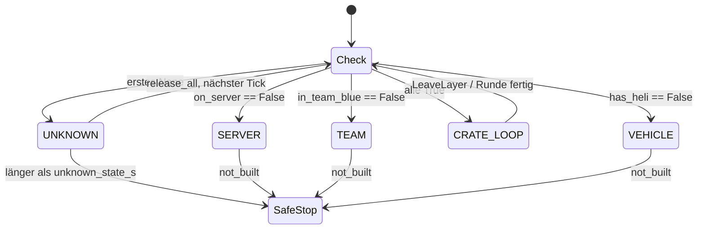
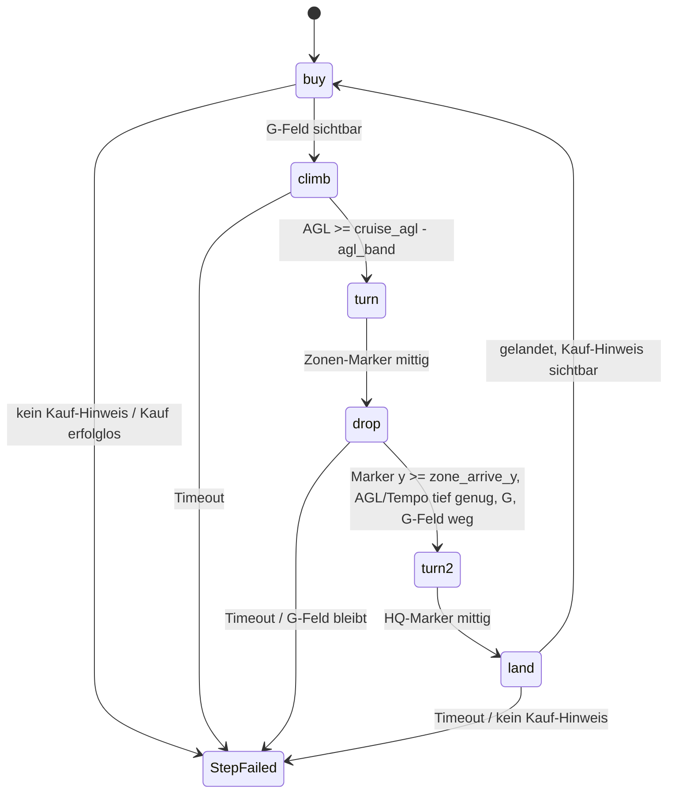
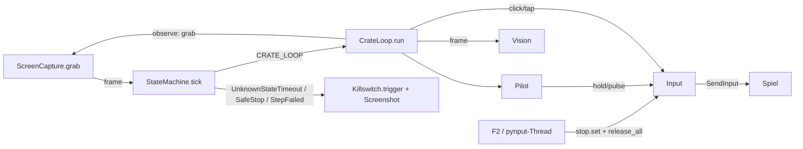

# Architektur

## Module (`src/heli_farmer/`)

| Modul | Aufgabe |
|---|---|
| `config.py` | `load_config(path)`: lädt `config.yaml`, merged `config.local.yaml` (gleiches Verzeichnis, optional) rekursiv darüber. `merge(base, override)` |
| `killswitch.py` | `Killswitch`: pynput-Keyboard-Listener, bei `keys.stop` → `stop.set()` + `on_stop()` (= `Input.release_all`). `wait(stop, s)` wirft `Stopped`. `key_name(key)` normalisiert pynput-Keys auf Strings (`"f2"`, `"w"`, `"space"`, `"vk<n>"`) |
| `inputs.py` | `Input`: `key_down/key_up/hold/tap/click/mouse_down/mouse_up` über pydirectinput (`SendInput`, Scan-Codes). Merkt gedrückte Tasten mit Startzeit, `release_overdue(limit_s)` lässt zu lange gehaltene Tasten los, `release_all()`. Nach Stop wirft Drücken `Stopped`. `dry_run=True` loggt statt zu senden |
| `capture.py` | `ScreenCapture(region).grab()` → BGR `np.ndarray` (H×W×3, uint8) der Spielregion via `mss` |
| `logs.py` | `setup_logging(root, level, name)` → `logs/<YYYY-MM-DD>/<name>_<HHMMSS>.log` + Konsole. `save_debug_screenshot(run_dir, frame, reason)` → `<run_dir>/screenshots/<HHMMSS_ffffff>_<reason>.png` |
| `detectors.py` | `Vision(config["vision"])`: Detektoren `frame → Ergebnis` (siehe unten). Stubs `on_server`, `in_team_blue` (→ `None`) für Layer 3/4 |
| `flight.py` | `Trend` (Änderungsrate über `history_s`), `Pilot`: Regler für Höhe (Shift/Ctrl), Tempo (W/S-Tipps), Gieren (Q/E-Pulse), Sinkrate |
| `crate_loop.py` | `CrateLoop`: Layer 1 als Schritte `buy, climb, turn, drop, land`, Sicherheitsprüfung pro Tick, Statistik |
| `states.py` | Hierarchische State Machine: `Detectors`, `detect`, `classify`, `Watchdog`, `StateMachine`, `SafeStop`, `not_built(layer)` |
| `main.py` | CLI, Aufbau der State Machine, Hauptschleife, Exit-Codes |

## Detektoren (`Vision`)

Alle arbeiten auf einem 1920×1080-BGR-Frame. Koordinaten, Templates und Schwellen in `config.yaml` → `vision`, Templates in `assets/`. Herleitung und Messwerte: `docs/ANALYSIS.md`.

| Methode | Ergebnis | Verfahren |
|---|---|---|
| `in_lakota` | bool | Template „Z20 LAKOTA“ in festem Fenster (`x, y, search`) |
| `crate_loaded` | bool | Template „G“-Feld |
| `buy_prompt` | bool | Template „[B] BUY AMMO / SUPPLIES“ |
| `delivered` | bool | Template „SUPPLIES DELIVERED“ |
| `first_aid` | bool | Template Erste-Hilfe-Stern |
| `garage_menu` | `"main"`, `"logistics"`, `None` | Templates der Menütitel |
| `heli_damaged` | bool | Median `R − max(G,B)` im Bereich der Heli-Silhouette ≥ `min_red` |
| `has_heli` | `bool \| None` | Erste-Hilfe → `False`; Kaufmenü → `True`; „Z20 LAKOTA“ → `not heli_damaged`; sonst `None` |
| `speed`, `agl` | `int \| None` | Ziffernleser: Top-Hat, rechtsbündige Ziffernsuche, Kosinus-Vergleich mit `digits.png` |
| `zone_marker`, `hq_marker` | `Marker(x, y, score) \| None` | Template im Band `band`, Maske als Alpha-Kanal im PNG, außerhalb der Maske mit Mittelwert gefüllt, TM_CCOEFF_NORMED. `anchor` = Markerpunkt im Template |
| `score(frame, name)`, `seen(frame, name)` | float / bool | Template-Vergleich im Fenster `x±search, y±search` |

Template-Fenster liegen außerhalb der Overlay-Fläche der OBS-Videos (x 600–1500, y 0–370). Ausnahme sind die Marker: Sie werden im ganzen Band gesucht, im Spiel gibt es kein Overlay.

## State Machine

`Layer` (IntEnum): `SERVER=4`, `TEAM=3`, `VEHICLE=2`, `CRATE_LOOP=1`, `UNKNOWN=-1`. Der Layer benennt, was der Bot als Nächstes tun muss.

Pro Tick:

1. `detect(frame, Detectors)` → `{"on_server", "in_team_blue", "has_heli"}` mit `bool | None`
2. `classify(results)` prüft von außen nach innen (`LAYER_CHECKS`). Erste Bedingung `False` → deren Layer; erste `None` → `UNKNOWN`; alle `True` → `CRATE_LOOP`
3. `Watchdog.expired(layer, now)`: `UNKNOWN` ununterbrochen länger als `timeouts.unknown_state_s` → `UnknownStateTimeout`
4. Handler `handlers[layer](frame)`

Handler in `main.build_machine`:

| Modus | Detektoren | Handler |
|---|---|---|
| ohne `--layer` | `on_server`, `in_team_blue` = Stubs (`None`), `has_heli` = `Vision.has_heli` | nur `UNKNOWN: release_all` → Watchdog stoppt |
| `--layer 1` | `on_server`, `in_team_blue` = immer `True`, `has_heli` = `Vision.has_heli` | `CRATE_LOOP`: `CrateLoop.run`, danach `Finished` bei `--once/--step`; `VEHICLE/TEAM/SERVER`: `not_built` → `SafeStop`; `UNKNOWN`: `release_all` |

## Layer 1: `CrateLoop`

Startzustand: Pilot im Z20 Lakota, gelandet im Kaufbereich der blauen Base. Eine Runde = `ROUND = (buy, climb, turn, drop, turn, land)`. `run(steps, once)`: Dauerlauf, eine Runde oder nur die angegebenen Schritte. Am Ende jedes Schritts `Pilot.release()`, am Ende von `run` `Input.release_all()`.

`observe()` (jeder Tick, alle Schritte): `wait(tick_s)` → `Pilot.update()` (abgelaufene Pulse loslassen) → `Input.release_overdue(max_hold_s)` → `grab()` → Prüfungen:

| Prüfung | Folge |
|---|---|
| `first_aid` | `LeaveLayer("Erste-Hilfe-Symbol")` |
| `in_lakota` und `heli_damaged` | `LeaveLayer("Heli beschädigt")` |
| weder `in_lakota` noch Kaufmenü länger als `timeouts.heli_lost_s` | `LeaveLayer("Heli-Anzeige weg")` |

`main.bot_loop` fängt `LeaveLayer` (alle Tasten los, nächster Tick klassifiziert neu → meist `VEHICLE` → `SafeStop`), `StepFailed`/`SafeStop`/`UnknownStateTimeout` (Killswitch auslösen, Screenshot, Exit 3 bzw. 2).

| Schritt | Ablauf |
|---|---|
| `buy` | Kiste schon geladen → fertig. Sonst Kauf-Hinweis nötig → B → warten auf Menü (`main` oder `logistics`) → ggf. Klick `logistics` → Klick `pallets` → Klick `ammo_pallet` → warten auf `main` → Klick `confirm` → warten auf G-Feld. `buy.attempts` Versuche, dann `StepFailed` |
| `climb` | `Pilot.altitude(agl, cruise_agl)` bis Zielhöhe |
| `turn` | Ziel = Zonen-Marker wenn Kiste geladen, sonst HQ-Marker. Höhe halten, Tempo 0. Kein Marker → `Pilot.search()` (Puls rechts). Fertig wenn `|x − center_x| ≤ yaw_deadband` |
| `drop` | Reiseflug (`cruise_agl`, `cruise_speed`, Gieren zum Marker) bis Marker nicht am Rand und `y ≥ zone_arrive_y`. Dann `drop_agl`/`drop_speed` halten; sobald erreicht: G tippen, warten bis G-Feld `vision.confirm`-mal weg, danach bis `delivered_wait_s` auf „SUPPLIES DELIVERED“ |
| `land` | Reiseflug zum HQ-Marker bis Marker `y ≥ hq_approach_y` oder Kauf-Hinweis → bremsen (Tempo 0, Höhe halten) bis `approach_speed` → `Pilot.sink` + Tempo 0 bis AGL ≤ `landed_agl` und Tempo ≤ `landed_speed` für `landed_hold_s` → Kauf-Hinweis prüfen |

Statistik `CrateLoop.stats` (`Counter`): `bought`, `dropped`, `delivered`, `rounds`. Wird pro Runde und beim Beenden geloggt.

### Regler (`Pilot`)

| Methode | Verhalten |
|---|---|
| `altitude(agl, target)` | Vorhersage `agl + rate × agl_lookahead_s`. Unter `target − agl_band` → Shift halten. Über `target + agl_band` → Shift los, über `target + 3·agl_band` zusätzlich Ctrl. Dazwischen Shift-Zustand behalten (Hysterese), Ctrl los |
| `speed(speed, target)` | Soll-Beschleunigung `clamp(speed_gain × (target − speed), ±accel_max)`. Gemessene Beschleunigung (Trend) kleiner als Soll − `accel_band` → W-Puls `tap_s`; größer als Soll + `accel_band` → S-Puls. Höchstens alle `speed_tap_interval_s` |
| `yaw(x)` | Fehler `x − center_x`. Innerhalb `yaw_deadband` → `True`. Sonst Q- oder E-Puls, Dauer `clamp(|Fehler| × yaw_s_per_px, yaw_min_s, yaw_max_s)`, frühestens nach `yaw_interval_s` und nicht während eines laufenden Gier-Pulses |
| `search()` | E-Puls `yaw_max_s`, wenn kein Gier-Puls läuft |
| `sink(agl)` | Soll-Sinkrate `sink_rate` (über 10 m) bzw. `sink_rate_min`; zu schnell → Shift, zu langsam → Ctrl, sonst beide los |
| `update()` / `release()` | abgelaufene Pulse loslassen / alle Flugtasten los |

Pulse sind nicht blockierend: `key_down` sofort, `key_up` im ersten `update()` nach Ablauf. Damit laufen Höhe, Tempo und Gieren im selben Tick.

## Datenfluss Bot (`main.py`)

CLI: `python -m heli_farmer.main [--config] [--dry-run] [--hold-test] [--layer 1] [--once] [--step buy|climb|turn|drop|land] [--map NAME]`. `--once`/`--step` nur mit `--layer 1`. `--map` wählt `maps.<NAME>`, gemerged über `maps.default`.

Exit-Codes: 0 Stopp/fertig, 1 unerwarteter Fehler, 2 Watchdog (unbekannter Zustand), 3 sicherer Stopp (`SafeStop`, `StepFailed`).

## Config-Abschnitte (Code-Sicht)

| Abschnitt | Nutzer |
|---|---|
| `game_region` | `ScreenCapture`, Klick-Offset in `CrateLoop` |
| `keys` | Killswitch (`stop`), Aufnahme (`record`), Bot (`shop, drop, up, down, forward, back, yaw_left, yaw_right`) |
| `loop.tick_s` | Hauptschleife außerhalb Layer 1 |
| `timeouts` | `unknown_state_s` (Watchdog), `max_hold_s` (`release_overdue`), `heli_lost_s` (`observe`) |
| `vision` | `Vision`; `confirm` = gleiche Messungen in Folge für Zustandswechsel der Kiste |
| `buy` | Klickpunkte und Wartezeiten des Kaufs |
| `flight` | `Pilot` und Schritt-Timeouts, `tick_s` = Takt in Layer 1 |
| `maps.default` + `maps.<name>` | Flugparameter pro Map: `cruise_agl, cruise_speed, zone_arrive_y, drop_agl, drop_speed, approach_speed, hq_approach_y` |
| `overlay` | nur `tools/overlay_inputs.py` |
| `recording`, `hold_test`, `logging` | Aufnahme, Hold-Test, Logs |

## Tools (`tools/`, Aufruf `python -m tools.<name>` aus dem Repo-Root)

### `record.py` – Aufnahme

- Hauptprozess: pynput-Keyboard- und Maus-Listener. `keys.record` toggelt, `keys.stop` beendet. Key-Down nur beim ersten Down (Autorepeat gefiltert)
- `Recorder.start()`: `recordings/<map>/<seq>_<YYYYmmdd_HHMMSS>/`, `meta.json`, `t0 = perf_counter()`, Kindprozess `record_video` (Capture-Thread → Queue → `cv2.VideoWriter` `mp4v` + `frames.csv`)

| Datei | Format |
|---|---|
| `frames.csv` | `frame,t` – Frame-Index, Sekunden seit `t0` |
| `inputs.jsonl` | je Zeile JSON, `t` in Sekunden seit `t0`, monoton. `{"type":"key","key":<key_name>,"action":"down"\|"up"}`, `{"type":"button",...}`, `{"type":"move","x":…,"y":…}` |
| `meta.json` | `region`, `fps`, `scale`, `video_size`, `started`, `clock` |

### `overlay_inputs.py` – Tasten aus OBS-Overlay

`analyse(video, config)` → Liste von Ereignissen im `inputs.jsonl`-Format (`type: key`), sortiert nach `t` (Video-Zeit). Ausgabe `<video>.inputs.jsonl` neben dem Video.

- `key_levels(frame, overlay)`: Gelbanteil `min(G,R) − B`, Median über `overlay.patches` je Taste (Raster `origin`, `pitch`, `keys: name → [zeile, spalte]`)
- `KeyTracker(on, off)`: Hysterese, Ereignis bei Zustandswechsel. Jedes `overlay.step`-te Frame
- `ImageTracker(vision, keys, confirm)`: jedes `overlay.image_step`-te Frame. `b` (down+up) wenn `garage_menu` von `None` auf offen wechselt; `g` wenn die Kiste (nur bei sichtbarem „Z20 LAKOTA“) nach `confirm` gleichen Messungen von geladen auf leer wechselt

### `video.py` – gemeinsames Video-Lesen

`iter_frames(video, select)` → `(index, t, frame)`. `t` aus `frames.csv` neben dem Video, falls vorhanden, sonst `CAP_PROP_POS_MSEC` (OBS). `select(index, t)` entscheidet vor dem Dekodieren (`grab` vs. `retrieve`).

### `extract_frames.py`

`extract(video, out_dir, select, crop)` → PNGs `t<sekunden:09.3f>.png`. Selektoren `at_times([..])`, `every(s)`. Standardziel `debug/frames/<ordner>_<stem>/`.

### `replay.py` – Layer-1-Timeline

`timeline(video, config, step)`: jedes `step`-te Frame auf `game_region` skalieren, `readings(vision, frame)` (lakota, menu, crate, speed, agl, buy_prompt, delivered, first_aid, damaged), dazu `situation(row, landed_agl, landed_speed)`:

| Situation | Bedingung (in dieser Reihenfolge) |
|---|---|
| `DEAD` | Erste-Hilfe-Stern |
| `BUY_MENU` | Kaufmenü offen |
| `NO_HELI` | kein „Z20 LAKOTA“ |
| `DAMAGED` | Heli-Symbol rot |
| `LANDED_BASE` / `LANDED` | AGL ≤ `landed_agl` und Tempo ≤ `landed_speed`, mit/ohne Kauf-Hinweis |
| `TO_ZONE` / `TO_BASE` | in der Luft mit/ohne Kiste |

`segments(rows, min_rows)` fasst gleiche Situationen zusammen und schluckt kürzere Abschnitte. `drops(rows, confirm)` = Abwurfzeitpunkte. CSV nach `debug/replay/<ordner>_<stem>.csv`. `tests/test_replay_videos.py` (Marker `videos`, nur lokal mit Videos) vergleicht Abwürfe, Kaufmenüs, Schaden und Tod mit `docs/ANALYSIS.md`.

## Tests

- `tests/fixtures/`: zugeschnittene Frames aus allen drei Videos + `fixtures.json` (`file`, `x`, `y` = Position des Ausschnitts im 1920×1080-Frame, erwartete Werte). Tests setzen den Ausschnitt in ein schwarzes Vollbild und rufen den Detektor auf
- `tests/test_crate_loop.py`: simulierte Welt (Höhe, Tempo, Marker reagieren auf Tasten) für jeden Schritt und eine ganze Runde
- `pytest -m videos`: langsamer Abgleich mit den Videos (Standardlauf überspringt ihn)
