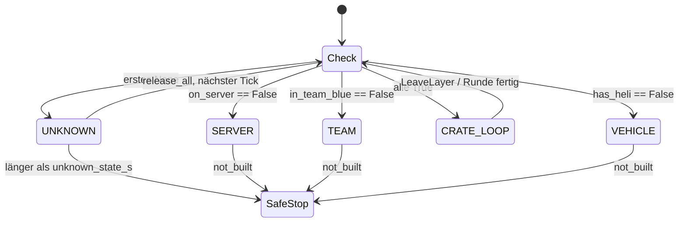
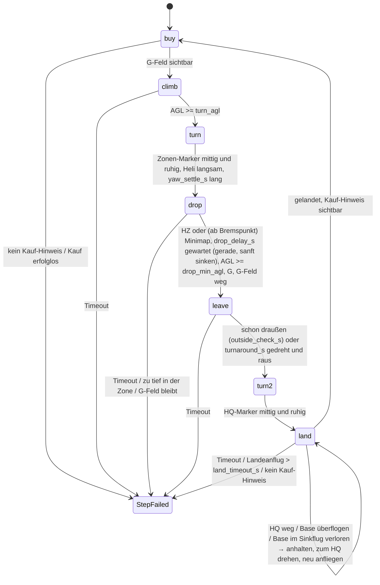
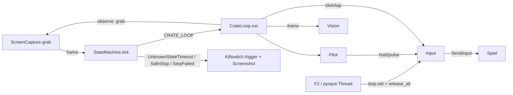

# Architektur

## Module (`src/heli_farmer/`)

| Modul | Aufgabe |
|---|---|
| `config.py` | `load_config(path)`: lädt `config.yaml`, merged `config.local.yaml` (gleiches Verzeichnis, optional) rekursiv darüber. `merge(base, override)` |
| `killswitch.py` | `Killswitch`: pynput-Keyboard-Listener, bei `keys.stop` → `stop.set()` + `on_stop()` (= `Input.release_all`). `wait(stop, s)` wirft `Stopped`. `key_name(key)` normalisiert pynput-Keys auf Strings (`"f2"`, `"w"`, `"space"`, `"vk<n>"`) |
| `inputs.py` | `Input`: `key_down/key_up/hold/tap/click/mouse_down/mouse_up` über pydirectinput (`SendInput`, Scan-Codes). Merkt gedrückte Tasten mit Startzeit, `release_overdue(limit_s)` lässt zu lange gehaltene Tasten los, `release_all()`. Nach Stop wirft Drücken `Stopped`. `dry_run=True` loggt statt zu senden. `focused()` (optional): vor jedem `key_down`/`mouse_down`/`click` und in `CrateLoop.observe` → `wait_for_focus()`: nicht im Vordergrund → `release_all`, pollen alle `focus_poll_s` bis wieder vorne, Wartezeit summiert in `paused_s` |
| `window.py` | `foreground_title()` (Win32 `GetForegroundWindow`/`GetWindowTextW` über ctypes), `is_foreground(title)`: Titel exakt gleich (getrimmt, ohne Groß/Klein) |
| `capture.py` | `ScreenCapture(region).grab()` → BGR `np.ndarray` (H×W×3, uint8) der Spielregion via `mss` |
| `logs.py` | `setup_logging(root, level, name)` → `logs/<YYYY-MM-DD>/<name>_<HHMMSS>.log` + Konsole. `save_debug_screenshot(run_dir, frame, reason)` → `<run_dir>/screenshots/<HHMMSS_ffffff>_<reason>.png` |
| `detectors.py` | `Vision(config["vision"])`: Detektoren `frame → Ergebnis` (siehe unten). Stubs `on_server`, `in_team_blue` (→ `None`) für Layer 3/4 |
| `flight.py` | `Trend` (Änderungsrate über ein Zeitfenster, `reset`, `ready` ab 2 Werten), `Pilot`: Regler für Höhe (Shift/Ctrl), Tempo/Nicklage (W/S-Tipps), Querneigung (A/D-Pulse), Gieren (gedämpfte Q/E-Pulse), Sinkrate |
| `crate_loop.py` | `CrateLoop`: Layer 1 als Schritte `buy, climb, turn, drop, land`, Sicherheitsprüfung pro Tick, Statistik |
| `states.py` | Hierarchische State Machine: `Detectors`, `detect`, `classify`, `Watchdog`, `StateMachine`, `SafeStop`, `not_built(layer)` |
| `main.py` | CLI, Aufbau der State Machine, Hauptschleife, Exit-Codes |

## Detektoren (`Vision`)

Alle arbeiten auf einem 1920×1080-BGR-Frame. Koordinaten, Templates und Schwellen in `config.yaml` → `vision`, Templates in `assets/`. Herleitung und Messwerte: `docs/ANALYSIS.md`.

| Methode | Ergebnis | Verfahren |
|---|---|---|
| `in_lakota` | bool | Template „Z20 LAKOTA“ in festem Fenster (`x, y, search`) |
| `crate_loaded` | bool | Template „G“-Feld |
| `buy_prompt` | bool | Template „[B] BUY AMMO / SUPPLIES“ |
| `delivered` | bool | Template „SUPPLIES DELIVERED“ |
| `first_aid` | bool | Template Erste-Hilfe-Stern |
| `garage_menu` | `"main"`, `"logistics"`, `None` | Templates der Menütitel |
| `round_over` | bool | Template „NEXT ROUND IN“ unten mittig (Rundenende-Bildschirm, ohne die Zeit) |
| `slots_full` | bool | Template „⚠ LOGISTICS SLOTS FULL“ unter der Logistik-Kachel im Hauptmenü (= Palette schon geladen) |
| `heli_damaged` | bool | Median `R − max(G,B)` im Bereich der Heli-Silhouette ≥ `min_red` |
| `has_heli` | `bool \| None` | Erste-Hilfe → `False`; Kaufmenü → `True`; „Z20 LAKOTA“ → `not heli_damaged`; sonst `None` |
| `speed`, `agl`, `asl` | `int \| None` | Ziffernleser: Top-Hat, rechtsbündige Ziffernsuche, Kosinus-Vergleich mit `digits.png` |
| `roll` | `int \| None` (Grad, + = nach rechts geneigt) | Lageanzeige unten mittig: Top-Hat um `roll.center`, je Winkel −`max_deg`…`max_deg` (1°) Mittelwert auf zwei gegenüberliegenden Radialstücken `radius` (die beiden Horizont-Striche); Score = Minimum beider Seiten, bester Winkel. `None`, wenn Score < `min_score` (HUD weg, Strich auf hellem Grund unsichtbar) |
| `zone_marker`, `hq_marker` | `Marker(x, y, score, kind, distance) \| None` | Template im Band `band`, Maske als Alpha-Kanal im PNG, außerhalb der Maske mit Mittelwert gefüllt, TM_CCOEFF_NORMED. `anchor` = Markerpunkt im Template. Zone: `kind` `"CZ"`/`"HZ"` (Buchstabenfeld `letter` gegen CZ- und HZ-Template). `distance` in m (Zone und HQ) |
| `_distance(frame, marker, strip, centered)` | `int \| None` | Text im Streifen `strip` relativ zum Marker; Zone: `distance.strip` über dem Marker, zentriert; HQ: `hq_marker.distance_strip` rechts daneben, linksbündig ab Streifenanfang. Je Format aus `formats` (`d` = Ziffer) Glyphen aus `distance_glyphs.png` an festen, zentrierten Positionen (`advance`, ±`shift`, ±`slack`) per TM_CCOEFF_NORMED. Bestes Format = größte Summe `score − min_gain`; `None`, wenn die schwächste Glyphe < `min_score`. CZ: Abstand zum Zonenrand, HZ: zur Zonenmitte |
| `minimap_over_base` | bool | Wie `minimap_in_zone`, aber Schwelle `base_chroma` (10): Base-Färbung ist schwächer (Ozeti nach der Landung 11–13, Regen 12). Nur in `land` |
| `minimap_in_zone` | bool | Median-BGR im Ring `ring` um `center` der Minimap, `max − min ≥ min_chroma` (Zonen-Färbung). Färbt auch in Base und fremden Zonen → zählt in `drop` erst ab dem Bremspunkt. Weißer Zonenkreis ist nicht bunt und wird nicht erkannt (dann HZ) |
| `score(frame, name)`, `seen(frame, name)` | float / bool | Template-Vergleich im Fenster `x±search, y±search` |

Template-Fenster liegen außerhalb der Overlay-Fläche der OBS-Videos (x 600–1500, y 0–370). Ausnahme sind die Marker: Sie werden im ganzen Band gesucht, im Spiel gibt es kein Overlay.

## State Machine

`Layer` (IntEnum): `SERVER=4`, `TEAM=3`, `VEHICLE=2`, `CRATE_LOOP=1`, `UNKNOWN=-1`. Der Layer benennt, was der Bot als Nächstes tun muss.

Pro Tick:

1. `detect(frame, Detectors)` → `{"on_server", "in_team_blue", "has_heli"}` mit `bool | None`
2. `classify(results)` prüft von außen nach innen (`LAYER_CHECKS`). Erste Bedingung `False` → deren Layer; erste `None` → `UNKNOWN`; alle `True` → `CRATE_LOOP`
3. `Watchdog.expired(layer, now)`: `UNKNOWN` ununterbrochen länger als `timeouts.unknown_state_s` → `UnknownStateTimeout`
4. Handler `handlers[layer](frame)`

Handler in `main.build_machine`:

| Modus | Detektoren | Handler |
|---|---|---|
| ohne `--layer` | `on_server`, `in_team_blue` = Stubs (`None`), `has_heli` = `Vision.has_heli` | nur `UNKNOWN: release_all` (bei `round_over` → `RoundOver`) → Watchdog stoppt |
| `--layer 1` | `on_server`, `in_team_blue` = immer `True`, `has_heli` = `Vision.has_heli` | `CRATE_LOOP`: `CrateLoop.run`, danach `Finished` bei `--once/--step`; `VEHICLE/TEAM/SERVER`: `not_built` → `SafeStop`; `UNKNOWN`: `release_all`, bei `round_over` → `RoundOver` |

## Layer 1: `CrateLoop`

Startzustand: Pilot im Z20 Lakota, gelandet im Kaufbereich der blauen Base. Eine Runde = `ROUND = (buy, climb, turn, drop, leave, turn, land)`. `run(steps, once)`: Dauerlauf, eine Runde oder nur die angegebenen Schritte. Am Ende jedes Schritts `Pilot.release()`, am Ende von `run` `Input.release_all()`.

`observe()` (jeder Tick, alle Schritte): `wait(tick_s)` → `Pilot.update()` (abgelaufene Pulse loslassen) → `Input.release_overdue(max_hold_s)` → `grab()` → Prüfungen:

| Prüfung | Folge |
|---|---|
| `round_over` | `RoundOver` (Unterklasse von `SafeStop`) → sicherer Stopp mit Screenshot |
| `first_aid` | `LeaveLayer("Erste-Hilfe-Symbol")` |
| `in_lakota` und `heli_damaged` | `LeaveLayer("Heli beschädigt")` |
| weder `in_lakota` noch Kaufmenü länger als `timeouts.heli_lost_s` | `LeaveLayer("Heli-Anzeige weg")` |

`main.bot_loop` fängt `LeaveLayer` (alle Tasten los, nächster Tick klassifiziert neu → meist `VEHICLE` → `SafeStop`), `StepFailed`/`SafeStop`/`UnknownStateTimeout` (Killswitch auslösen, Screenshot, Exit 3 bzw. 2).

| Schritt | Ablauf |
|---|---|
| `buy` | Kiste schon geladen → fertig. Menü zu: Kauf-Hinweis nötig → B. Warten auf Menü (`main` oder `logistics`). `main` mit `slots_full` → nur bestätigen. Sonst ggf. Klick `logistics` (kommt das Menü nicht → nur bestätigen) → `pallets` → `ammo_pallet` → warten auf `main`. Bestätigen: Klick `confirm`, bis `garage_menu` `None` ist, höchstens `buy.confirm_attempts`-mal, sonst `StepFailed`. Dann warten auf G-Feld. `buy.attempts` Versuche, dann `StepFailed`. Klick = `moveTo`, `hover_s` warten, Maustaste `press_s` halten, danach `pause_s` |
| `climb` | `Pilot.fly` mit Tempo 0 bis AGL ≥ `turn_agl` („ein paar Meter“, am Boden wirkt Gieren nicht) |
| `turn` | Hinflug (Kiste geladen): Ziel Zonen-Marker, Höhe `turn_agl`. Rückflug: Ziel HQ-Marker, Höhe `cruise_agl`. Pro Tick `_align(frame, marker, agl)` mit zwei Modi nach Tempo (Hysterese: rein über `curve_min_speed`, raus unter `curve_min_speed − speed_band`, Log beim Wechsel): **Kurvenflug** (`_curve`): `_fly` mit Tempo-Soll `turn_speed`, `floor = min(min_agl, agl − agl_band)`, `x` = Marker oder Bildrand der Suchseite (`_edge`), Schräglage bis `turn_bank`; fertig, wenn `Pilot.on_target`. **Auf der Stelle:** Tempo-Soll 0; kein Marker → `Pilot.search(Seite)`; sonst `_fly(..., x)`; fertig, wenn `on_target` und Tempo ≤ `hover_speed`. Seite = wo der Marker zuletzt war (Start rechts). Fertig erst nach `yaw_settle_s` am Stück. Timeout `turn_timeout_s` |
| `drop` | Bis zum Eintritt: zum Zonen-Marker gieren und bei Tempo neigen (`_fly` mit `x`). Reiseflug (`_cruise`: `cruise_agl`, `cruise_speed`, `floor = min_agl`), bis der Median der letzten `distance_history` CZ-Entfernungen ≤ `brake_distance` → Anflug (`_approach`: `drop_agl`, `drop_speed`, `floor = drop_agl − agl_band`, `sink_rate = drop_sink_rate`). Zone erreicht = `kind == "HZ"` oder (`approach` und `minimap_in_zone`) in `vision.confirm` Bildern in Folge (Log nennt HZ oder Minimap), `entered` wird nur einmal gesetzt. Danach `_hold_level`: kein Gieren, Querneigung → 0, keine W/S-Tipps außer Sicherheitsregeln, sanft (≤ `drop_sink_rate`) auf `drop_agl`. Nach `drop_delay_s` G, sobald AGL ≥ `drop_min_agl` (keine Obergrenze; sonst einmal Log `Warte auf Abwurfhöhe`); nach `drop_wait_s` `StepFailed` mit AGL. G-Druck: warten bis G-Feld `vision.confirm`-mal weg, dann bis `delivered_wait_s` auf „SUPPLIES DELIVERED“; dabei `_hold_level` |
| `leave` | Zuerst bis `outside_check_s` prüfen, ob schon draußen (`_outside` `vision.confirm`-mal: Marker sichtbar → `kind == "CZ"`, sonst Minimap ohne Färbung) → fertig (Schwung nach G). Sonst Drehrichtung weg vom Marker (Marker rechts → Q, sonst E), `turnaround_s` lang: über `curve_min_speed` `_curve` zum Bildrand dieser Seite (A/D + Q/E, Tempo-Soll `turn_speed`), sonst `Pilot.search(Richtung)` bei Tempo 0, Höhe `cruise_agl`. Dann Reiseflug geradeaus bis draußen, danach noch `leave_margin_s` geradeaus |
| `land` | Phasen `cruise` → `approach` → `descend`, dazu `turn`. HQ-Entfernung: Median der letzten `distance_history` Werte, `lost` = HQ-Marker länger als `hq_lost_s` weg. **cruise:** `_cruise` mit `x` zum HQ-Marker; `lost` → `turn`; Entfernung ≤ `land_distance` oder Marker `y ≥ hq_approach_y` oder Kauf-Hinweis → `approach`, ab jetzt Frist `land_timeout_s` (danach `StepFailed`). **approach:** `approach_agl`, Tempo-Soll `max(approach_speed, Entfernung × approach_speed_per_m)` (`_approach_speed`), `sink_rate = approach_sink_rate`, gieren nur, solange Entfernung > `hq_overhead_distance`; `nearest` = kleinste Entfernung. Entfernung > `nearest + hq_overshoot_m` oder (`lost` und Minimap ohne Färbung) → Log `Base überflogen`, `turn`. Kauf-Hinweis oder (Minimap `confirm`-mal eingefärbt und (Entfernung ≤ `hq_overhead_distance` oder `lost`)) → `descend`. **descend:** `_descend` (`Pilot.descend` + `bank` gerade). Weder Kauf-Hinweis noch Minimap-Färbung `confirm`-mal in Folge → Log `Base nicht mehr unter dem Heli`, `turn`. AGL ≤ `landed_agl` und Tempo ≤ `landed_speed` für `landed_hold_s` → Kauf-Hinweis prüfen. **turn:** nach Anflugbeginn mit Kauf-Hinweis → `descend`; sonst `_align` auf den HQ-Marker (Höhe `cruise_agl`, nach Anflugbeginn `approach_agl`), fertig → zurück zu `cruise` bzw. `approach` mit geleertem Entfernungs-Puffer |

Statistik `CrateLoop.stats` (`Counter`): `bought`, `dropped`, `delivered`, `rounds`. Wird pro Runde und beim Beenden geloggt.

### Regler (`Pilot`)

| Methode | Verhalten |
|---|---|
| `fly(agl, asl, speed, target_agl, target_speed, floor, sink_rate, loaded)` | **Fluglage-Sicherheit zuerst:** `recovering` = AGL < `floor` oder (AGL < `safe_agl` und Tempo > `safe_speed`). Dann Shift, kein Gieren (`yaw` setzt `lead = None`), Querneigung 0, kein W außer Nase auf 0 zurück. **Höhe über Shift**: Vorhersage `agl + rate × agl_lookahead_s`, unter `target − agl_band` Shift halten, über `target + agl_band` los, dazwischen Zustand behalten. **Sanft sinken** nur mit `sink_rate > 0`: über `target + agl_band` Ctrl, solange die ASL-Rate > −`sink_rate`; sinkt er schneller als `sink_rate + sink_band` → Shift. **Nicklage über W/S-Pulse** (`pitch_tap_s`, höchstens alle `pitch_interval_s`), Entscheidungen nach `taps = round(tilt)`: S nur mit Nase vorne (`taps > 0`) und (Tempo > `speed_limit(agl) + speed_band` oder `sagging` (Shift gehalten, ASL-Rate < −`sink_guard`, nicht im Sinkmodus) bei Tempo ≥ `bank_speed` oder unter Sicherheitshöhe noch beschleunigend). W bei `sagging`, `taps ≤ 0` und Tempo < `bank_speed` (Rücklage) oder `recovering` mit `taps < 0`. `target_speed None` → sonst keine W/S-Tipps (Zone). Sonst `_pitch_for`. Grund: Mit Nase oben und Rückwärtsflug zeigt das HUD trotzdem Tempo; „zu schnell → S“ ohne `taps > 0` kippte den Heli immer weiter nach hinten (Test 17.10., 3. Durchgang) |
| `tilt` | Neigungsschätzung in Tipps (float): W +1, S −1 (Trimm-Tipps zählen nicht). Beim Loslassen wird die echte Pulsdauer nachgerechnet (`_count_overrun`: `±(Dauer / Soll − 1)`), weil Pulse erst im nächsten Tick enden (Bildtakt ~0,14 s → 0,2-s-Tipp dauert ~0,28 s). 0, sobald AGL ≤ `landed_agl` und Tempo ≤ `landed_speed`. Driftet trotzdem (Palette zieht die Nase hoch) |
| `speed_limit(agl)` | Höchsttempo je Höhe: lineare Interpolation in `speed_limits` (`[[agl, km/h], …]`), außerhalb konstant |
| `descend(agl, asl, speed)` | Landung: Soll-Steigrate (ASL-Trend) −`sink_rate` über `sink_slow_agl`, darunter −`sink_rate_min`; 0 solange Tempo > `descend_speed` (erst bremsen, dann sinken) oder (unter `sink_slow_agl`) Tempo > `touchdown_speed`. Zu schnell sinkend → Shift, zu langsam → Ctrl. Tempo-Soll 0 über `_pitch_for` |
| `yaw(x)` | Gedämpfter Gier-Regler (Heli dreht nach Q/E nach, siehe `docs/ANALYSIS.md`). Fehler `e = x − center_x`. Marker am Rand (`|e| ≥ center_x − edge_margin`, angeheftete Marker x≈120/1800): Drehrate unbekannt → `Trend` leeren, Puls `yaw_max_s` Richtung Rand. Sonst `x` in `_aim` (`Trend` über `yaw_history_s`), erst ab 2 Werten: Rate `r` (px/s), `lead = e + r × yaw_lookahead_s` (Haltepunkt). `on_target = |e| ≤ yaw_deadband` und `|r| ≤ yaw_still` und kein Gier-Puls. Puls, wenn `|lead|` größer als `yaw_deadband` (ruhig) bzw. `yaw_coast_band` (dreht noch): Richtung `sign(lead)` (Gegentaste = Bremsen), Dauer `clamp(|lead| × yaw_s_per_px, yaw_min_s, yaw_max_s)`. Alle Gier-Pulse über `_yaw_pulse`: nicht während eines Gier-Pulses und erst `yaw_wait_s` nach dessen Ende |
| `search(direction)` | `_aim` leeren, `on_target = False`, Gier-Puls `yaw_max_s` in `direction` (über `_yaw_pulse`) |
| `bank(roll, speed, lead, limit=0)` | Soll-Querneigung 0; mit `lead` (Haltepunkt aus `yaw`), nicht `recovering`: `clamp(lead × bank_per_px, ±Grenze)`, Grenze = `limit` (Kurvenflug, `turn_bank`) oder `max_bank × min(1, Tempo / bank_speed)` (auch langsam leicht neigen, gegen seitliches Abdriften). Fehler > `roll_band` → A- oder D-Puls, Dauer `clamp(|Fehler| × roll_s_per_deg, roll_min_s, roll_max_s)`, frühestens nach `roll_interval_s`, nicht während eines laufenden Roll-Pulses. `roll None` → nichts |
| `update()` / `release()` | abgelaufene Pulse loslassen (dabei `_count_overrun`) / alle Flugtasten los |
| `_pitch(key)` | Puls, wenn `pitch_interval_s` vorbei. **Rücklage-Grenze** (`_may_lean_back`): S mit `taps > 0` (Nase zurück zur Mitte) immer erlaubt; sonst nur bei `taps > −max_back_tilt` und weniger als `back_taps` solche Tipps in `back_window_s` |
| `_pitch_for(speed, target, accel, sinking, loaded)` | **Ziel ≤ `hover_speed` (Schweben/Bremsen):** Tempo ≤ `trim_speed` → `reverse = False`. Tempo ≤ `hover_speed` → nur bei Drift (Tempo > `trim_speed` und steigend): `tilt > 0` → S, `tilt < 0` oder `reverse` → W, `tilt == 0` mit Palette → Trimm-W (`trim_tap_s`, ungezählt), sonst nichts. Schneller: solange die Verzögerung < `brake_accel`, ein Brems-Tipp je `pitch_interval_s` (`_pitch_ready`): S, mit `reverse` W. Vorher: Beschleunigung größer als beim letzten Brems-Tipp und > `reverse_accel` und Tempo ≤ `reverse_max_speed` → Bremsrichtung war falsch → `reverse` umschalten; nach dem zweiten Umschalten (rutscht seitlich) nur noch Nase auf 0 (`_level`). Grund: Das HUD-Tempo hat kein Vorzeichen, der Neigungszähler `tilt` driftet; nur die Reaktion auf den Tipp zeigt die Flugrichtung. **Sonst:** Soll-Beschleunigung `clamp(speed_gain × (Ziel − Tempo), ±accel_max)`; Ist < Soll − `accel_band` oder Tempo < Ziel − `speed_band` ohne Beschleunigung (nicht beim Sinken) → W, solange `tilt < max_tilt`, darüber nur Trimm-W, wenn Ist < `trim_accel` (Nicklage verloren, z. B. Palette); Ist > Soll + `accel_band` → S |

`CrateLoop._trace` (aus `_fly` und `_descend`): höchstens alle `flight.trace_s` eine Log-Zeile `Flug: AGL, km/h, Schräglage, Neigung (Tipps), Marker-x, Tasten (Input.held), Sicherheit`. Für die Auswertung von Tests im Spiel.

Pulse sind nicht blockierend: `key_down` sofort, `key_up` im ersten `update()` nach Ablauf (Pulsdauer daher auf Tick-Länge gerundet, im Spiel ~0,14 s pro Tick mit Marker-Suche). Damit laufen Höhe, Tempo, Querneigung und Gieren im selben Tick. `CrateLoop._fly(frame, agl, speed, floor, sink_rate, x)` liest pro Tick AGL, ASL, Tempo, Querneigung und G-Feld (`loaded`), ruft `fly`, mit `x` zusätzlich `yaw(x)`, und `bank(roll, speed, lead, bank)` (ohne `x`: `lead = None`, gerade halten).

## Datenfluss Bot (`main.py`)

Start: `countdown(stop, loop.start_delay_s)` (Log pro Sekunde, F2 bricht ab), dann Log des Vordergrund-Titels. Fokusprüfung nur ohne `--dry-run` und ohne `--hold-test` (`focused = is_foreground(window.title)`). `CrateLoop`-Uhr = `monotonic() − Input.paused_s`: Schritt-Timeouts, Trends und Pulse stehen, solange auf das Spielfenster gewartet wird.

CLI: `python -m heli_farmer.main [--config] [--dry-run] [--hold-test] [--layer 1] [--once] [--step buy|climb|turn|drop|leave|land] [--map NAME]`. `--once`/`--step` nur mit `--layer 1`. `--map` wählt `maps.<NAME>`, gemerged über `maps.default`.

Exit-Codes: 0 Stopp/fertig, 1 unerwarteter Fehler, 2 Watchdog (unbekannter Zustand), 3 sicherer Stopp (`SafeStop`, `StepFailed`).

## Config-Abschnitte (Code-Sicht)

| Abschnitt | Nutzer |
|---|---|
| `game_region` | `ScreenCapture`, Klick-Offset in `CrateLoop` |
| `keys` | Killswitch (`stop`), Aufnahme (`record`), Bot (`shop, drop, up, down, forward, back, yaw_left, yaw_right, roll_left, roll_right`) |
| `loop` | `tick_s` Hauptschleife außerhalb Layer 1, `start_delay_s` Countdown vor dem ersten Tastendruck (auch Hold-Test) |
| `window` | `title` Fenstertitel des Spiels, `poll_s` Abfrageintervall beim Warten auf den Fokus |
| `timeouts` | `unknown_state_s` (Watchdog), `max_hold_s` (`release_overdue`), `heli_lost_s` (`observe`) |
| `vision` | `Vision`; `confirm` = gleiche Messungen in Folge für Zustandswechsel der Kiste |
| `buy` | Klickpunkte und Wartezeiten des Kaufs |
| `flight` | `Pilot` und Schritt-Timeouts, `tick_s` = Takt in Layer 1 |
| `maps.default` + `maps.<name>` | Flugparameter pro Map: `turn_agl, min_agl, cruise_agl, cruise_speed, brake_distance, drop_agl, drop_min_agl, drop_speed, approach_agl, approach_speed, land_distance, hq_approach_y` |
| `overlay` | nur `tools/overlay_inputs.py` |
| `recording`, `hold_test`, `logging` | Aufnahme, Hold-Test, Logs |

## Tools (`tools/`, Aufruf `python -m tools.<name>` aus dem Repo-Root)

### `record.py` – Aufnahme

- Hauptprozess: pynput-Keyboard- und Maus-Listener. `keys.record` toggelt, `keys.stop` beendet. Key-Down nur beim ersten Down (Autorepeat gefiltert)
- `Recorder.start()`: `recordings/<map>/<seq>_<YYYYmmdd_HHMMSS>/`, `meta.json`, `t0 = perf_counter()`, Kindprozess `record_video` (Capture-Thread → Queue → `cv2.VideoWriter` `mp4v` + `frames.csv`)

| Datei | Format |
|---|---|
| `frames.csv` | `frame,t` – Frame-Index, Sekunden seit `t0` |
| `inputs.jsonl` | je Zeile JSON, `t` in Sekunden seit `t0`, monoton. `{"type":"key","key":<key_name>,"action":"down"\|"up"}`, `{"type":"button",...}`, `{"type":"move","x":…,"y":…}` |
| `meta.json` | `region`, `fps`, `scale`, `video_size`, `started`, `clock` |

### `overlay_inputs.py` – Tasten aus OBS-Overlay

`analyse(video, config)` → Liste von Ereignissen im `inputs.jsonl`-Format (`type: key`), sortiert nach `t` (Video-Zeit). Ausgabe `<video>.inputs.jsonl` neben dem Video.

- `key_levels(frame, overlay)`: Gelbanteil `min(G,R) − B`, Median über `overlay.patches` je Taste (Raster `origin`, `pitch`, `keys: name → [zeile, spalte]`)
- `KeyTracker(on, off)`: Hysterese, Ereignis bei Zustandswechsel. Jedes `overlay.step`-te Frame
- `ImageTracker(vision, keys, confirm)`: jedes `overlay.image_step`-te Frame. `b` (down+up) wenn `garage_menu` von `None` auf offen wechselt; `g` wenn die Kiste (nur bei sichtbarem „Z20 LAKOTA“) nach `confirm` gleichen Messungen von geladen auf leer wechselt

### `video.py` – gemeinsames Video-Lesen

`iter_frames(video, select)` → `(index, t, frame)`. `t` aus `frames.csv` neben dem Video, falls vorhanden, sonst `CAP_PROP_POS_MSEC` (OBS). `select(index, t)` entscheidet vor dem Dekodieren (`grab` vs. `retrieve`).

### `extract_frames.py`

`extract(video, out_dir, select, crop)` → PNGs `t<sekunden:09.3f>.png`. Selektoren `at_times([..])`, `every(s)`. Standardziel `debug/frames/<ordner>_<stem>/`.

### `replay.py` – Layer-1-Timeline

`timeline(video, config, step, marker_every)`: jedes `step`-te Frame auf `game_region` skalieren, `readings(vision, frame)` (lakota, menu, crate, speed, agl, buy_prompt, delivered, first_aid, damaged). In jeder `marker_every`-ten Zeile mit Heli zusätzlich `marker_readings` (zone = `"CZ"`/`"HZ"`/`""`, distance, minimap, hq), sonst `None` (Marker-Suche ~100 ms/Bild). Dazu `situation(row, landed_agl, landed_speed)`:

| Situation | Bedingung (in dieser Reihenfolge) |
|---|---|
| `DEAD` | Erste-Hilfe-Stern |
| `BUY_MENU` | Kaufmenü offen |
| `NO_HELI` | kein „Z20 LAKOTA“ |
| `DAMAGED` | Heli-Symbol rot |
| `LANDED_BASE` / `LANDED` | AGL ≤ `landed_agl` und Tempo ≤ `landed_speed`, mit/ohne Kauf-Hinweis |
| `TO_ZONE` / `TO_BASE` | in der Luft mit/ohne Kiste |

`segments(rows, min_rows)` fasst gleiche Situationen zusammen und schluckt kürzere Abschnitte. `drops(rows, confirm)` = Abwurfzeitpunkte. `zone_visits(rows, confirm, history, brake_distance)` = (Eintritt, Austritt) nach den Regeln von `CrateLoop.drop`/`leave` (rein: HZ oder Minimap, Minimap nur wenn der Median der letzten `history` CZ-Entfernungen ≤ `brake_distance`, Entfernungen ohne Kiste verworfen; raus: CZ oder kein Marker und Minimap ohne Färbung, je `confirm` Marker-Zeilen in Folge). `brake_times(rows, history, brake_distance)` = erster Zeitpunkt pro Hinflug (Kiste geladen), an dem der Median der letzten `history` CZ-Entfernungen ≤ `brake_distance` ist. CSV nach `debug/replay/<ordner>_<stem>.csv`. `tests/test_replay_videos.py` (Marker `videos`, nur lokal mit Videos) vergleicht Abwürfe, Kaufmenüs, Schaden und Tod mit `docs/ANALYSIS.md` und prüft für jeden Abwurf: Zonen-Besuch erkannt, Bremspunkt vor dem Eintritt, kein HQ-Marker in der Zone, HQ-Marker kurz nach dem Verlassen.

## Tests

- `tests/fixtures/`: zugeschnittene Frames aus allen drei Videos + `fixtures.json` (`file`, `x`, `y` = Position des Ausschnitts im 1920×1080-Frame, erwartete Werte). Tests setzen den Ausschnitt in ein schwarzes Vollbild und rufen den Detektor auf
- `tests/test_crate_loop.py`: simulierte Welt nach Daniels Flugmodell (Nick- und Querneigung bleiben nach W/S bzw. A/D stehen, Shift hält bei 15° die Höhe, ohne Taste Schweben, Palette zieht die Nase mit 0,3°/s hoch, Q/E mit Nachdrehen nach der Video-Messung: 0,3 s Totzeit, 0,2 s Anlauf, 0,5 s Auslauf, 40°/s, bei Tempo schwächer; `World.substeps` simuliert langsamere Bildraten, Geschwindigkeit als Vektor (Schwung): Nicklage schiebt entlang der Nase, Querneigung seitlich, Luftwiderstand bremst; Windfahne (Heck dreht die Nase in die Flugrichtung, ∝ v² · sin Schiebewinkel) und Seitenkraft beim Schieben; Querneigung und Nicklage kosten Auftrieb, Fahrt gibt etwas Auftrieb (translational lift); HUD zeigt den Betrag), 2D-Position mit Kurs, Nase bis −40° nach hinten möglich (Rücklage-Crash nachstellbar), Zone mit Radius (CZ-Entfernung zum Rand, HZ innen, Minimap-Färbung), HQ in der Zone unsichtbar, Kauf-Hinweis nur nah an der Base und tief. Tests für jeden Schritt und eine ganze Runde; `assert_never_low_and_fast` prüft das Höchsttempo je Höhe über den ganzen Flug
- `pytest -m videos`: langsamer Abgleich mit den Videos (Standardlauf überspringt ihn)
